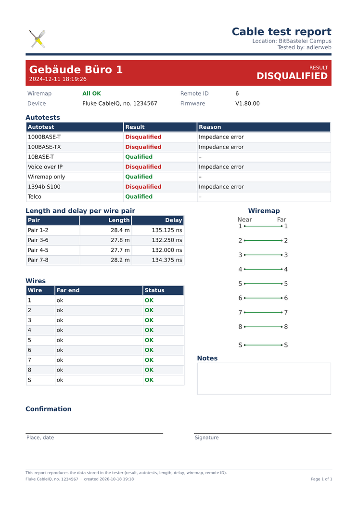

# CableIQ Client

Python client for the **Fluke Networks CableIQ** (USB `0f7e:0003`): read the measurements stored in the device, display them and export them as a PDF test report. The protocol was derived from a USB capture (see [docs/protocol.md](docs/protocol.md)).

> [!WARNING]
> **This code was largely written by an AI (Claude) and has not been independently reviewed.** The protocol was **not** obtained by disassembling or decompiling any software or firmware. It was reverse-engineered purely from USB captures and the results shown for a limited set of test cables (open, shorted, crossed wires and a few real runs). The decoding is therefore empirical:
>
> - Fault types, autotest reasons and result codes that did not occur in those measurements may be **missing or decoded wrongly**, or not shown at all.
> - Some rules (e.g. "Length (termination error)", the length shown by the device) are inferred from few samples; see [docs/protocol.md](docs/protocol.md) for what is confirmed and what is not.
> - **Do not rely on this tool alone** for acceptance tests, certification or other decisions with contractual or safety consequences. Check results against the device display.
> - The client only reads from the device, but it is provided without any warranty.

## Files

| File | Purpose |
|---|---|
| `cableiq_gui.py` | graphical interface (list, details, report details, PDF export; German/English, light/dark) |
| `cableiq_pdf.py` | wiremap drawing and PDF test report |
| `cableiq.py` | protocol library and command-line client (`list`, `show`, `dump`, `diff`, `save`) |
| `cableiq_store.py` | save and load a measurement set (JSON), usable without the GUI |
| `cableiq_i18n.py` | translation table (German/English), number and date formats |
| `docs/protocol.md` | documentation of the protocol and record format |
| `udev/70-cableiq.rules` | udev rule for access without root |
| `tools/usbcap.py` | captures USB traffic through usbmon (read access only) |
| `tools/frames.py` | splits a capture into protocol frames |
| `docs/` | image for the README (example PDF) |
| `tests/` | tests: decoding against reference values, measurement-set format, translations (`python3 -m unittest discover -s tests`) |

## Requirements

- Python 3, `pyusb` and `PySide6` (Arch: `python-pyusb`, `pyside6`)
- access to the USB device (see below)

## Usage

```
python3 cableiq_gui.py                              # reads from the device at start
python3 cableiq_gui.py --no-auto                    # start without reading (use "Read from device" later)
python3 cableiq_gui.py --pcap CAPTURE.pcap          # without a device, from a capture
python3 cableiq_gui.py --lang de                    # language for this session (de, en, auto)
python3 cableiq.py list                             # command line: list measurements
python3 cableiq.py show 3                           # details of one measurement (1 = newest)
python3 cableiq.py save set.json                    # save the measurements as a set
python3 cableiq.py --set set.json list              # look at a saved set (no device)
python3 cableiq_gui.py --set set.json               # open a saved set in the GUI
```

**GUI:** The list is on the left, the details of the selected measurement on the right. Below the list you find the location, logo and a default for the person who tested; they are saved to `~/.config/cableiq/config.json` (or `$XDG_CONFIG_HOME/cableiq/config.json`) when changed and reloaded at the next start.

**Language and appearance:** "Settings" (right end of the toolbar) offers the language (automatic, Deutsch, English) and the appearance (automatic, light, dark). "Automatic" picks the language from `LC_ALL`/`LANG` (German → German, otherwise English) and the appearance from the system. If the platform reports no colour scheme, the client sets its own palette for "Light" and "Dark". The language also applies to the PDF (texts, date and decimal separator), the command line (`--lang`) and the messages. The PDF always stays light so that it prints well. Both settings are saved.

**PDF test report:** "PDF test report" exports the selected or all measurements: one page per measurement, plus an overview when there are several.



**Saving and loading a measurement set:** "Save measurement set…" writes all measurements currently shown to a JSON file; "Load measurement set…" reads them back later, even without the device. The file contains the raw records (all values, results and reasons are recomputed from them), the serial number, changed "Tested by" lines, and the location, default tester and logo (embedded). On load the GUI asks whether the report details in the file should replace the current ones. The device is not contacted. Format: see [docs/protocol.md](docs/protocol.md), section 9.

**Notes and signature:** Each measurement has a notes field in the detail view. The text is stored in the configuration (`notes`), saved with the measurement set and printed in the PDF in a "Notes" box; without text the box stays empty so it can be filled in by hand. The option "Signature field in PDF" (under the report details) adds a field for place, date and signature to every page.

**Person who tested ("Tested by"):** The device stores two text lines per measurement. The GUI shows them in the detail view and lets you change them. A change applies to that measurement only, is stored in the configuration (`operators`, key made of device number, timestamp and cable ID) and appears in the PDF. "Device value" discards it. The device itself is never written to. If the device has no entry, the PDF uses the default from the report details.

## Access rights (udev)

Without a rule the device belongs to `root` and the client reports "No access to the USB device".

**Permanent** (recommended):

```
sudo cp udev/70-cableiq.rules /etc/udev/rules.d/
sudo udevadm control --reload
sudo udevadm trigger --subsystem-match=usb --attr-match=idVendor=0f7e
```

Then unplug the device once and plug it in again. The rule sets `TAG+="uaccess"`: the user of the local session gets access automatically (via ACL). It does not work for pure SSH sessions without a seat; use `GROUP="plugdev", MODE="0660"` there and add the user to the group.

**One-off** (until the device is replugged; find bus and device number with `lsusb`):

```
sudo setfacl -m u:$USER:rw /dev/bus/usb/<BBB>/<DDD>
```

## Windows and macOS (untested)

The code is plain Python with `pyusb` (libusb) and `PySide6`, so it should run on other platforms, but it has only been tried on Linux. The following is what to expect; please report what works.

```
pip install pyusb PySide6
```

- **Reading from a saved set or capture needs no USB at all** (`--set`, `--pcap`, PDF export, tests), so GUI, PDF and command line work on any platform where PySide6 does.
- **macOS:** install libusb (`brew install libusb`). No driver or rule is needed in the usual case. If the device cannot be opened, make sure no other program holds it and try running once with `sudo` to tell a permission problem from a different one.
- **Windows:** `pyusb` needs a libusb-1.0 DLL it can find (put `libusb-1.0.dll` next to `python.exe` or into a directory on `PATH`), and the device must be bound to the **WinUSB** (or libusbK) driver, for example with [Zadig](https://zadig.akeo.ie/). Binding replaces the manufacturer's driver for this device, so its own software stops seeing it until you restore the original driver in Device Manager.
- **Exclusive access:** as on Linux, no other program or virtual machine may hold the device.
- **Settings** are stored in `~/.config/cableiq/config.json` (`%USERPROFILE%\.config\cableiq\config.json` on Windows), not in the platform's usual location.
- **Language "Automatic"** reads the `LC_ALL`/`LANG` environment variables, which are usually not set on Windows; the interface then falls back to English. Choose the language in "Settings" or start with `--lang de`.
- `udev/70-cableiq.rules`, `setfacl` and `tools/usbcap.py` (usbmon) are Linux only and not needed for normal use.

## Notes

- **Exclusive:** The device must not be in use by another program or a VM at the same time (e.g. via USB redirection). Disconnect it there first.
- **Read-only:** The client only fetches the stored measurements and changes nothing on the device.
- **Qualification:** Result and autotests (1000BASE-T, 100BASE-TX, …) come from the data stored in the device and match the reference values of all reference measurements made during development. The reasons ("Wiremap", "Length (termination error)", "Impedance error") come from the reference measurements; an empirical rule applies to "Length (termination error)" (see the protocol documentation).
- **Wiremap column:** It shows the device's fault report for wires 1–8. Without a detected far end it reads "No far end".
- **Length in the list:** the longest of the four pair values. The device itself reports a length that may differ (field 0x100, also available as `Record.device_length`).
- **Lengths:** They are computed from the delay (NVP 70 %). On long runs the last decimal can differ from reference values.
- **Translations:** English is the base language: the English texts are the keys in `cableiq_i18n.py` (`tr("…")`) and the table there holds the German translation. A test makes sure every text in use has a German translation. Autotest names and reasons come from the record and are only translated for display; files (measurement set, configuration) stay language-independent.

## Making a capture (development)

usbmon can capture the device's USB traffic (even while it is passed into a VM):

```
sudo modprobe usbmon && sudo setfacl -m u:$USER:r /dev/usbmon3     # adjust the bus
python3 tools/usbcap.py /dev/usbmon3 <device number> out.pcap 600  # 600 seconds
python3 tools/frames.py out.pcap seq.pkl                           # show frames
```

The pcap file has link type `USB_LINUX` (189) and opens in Wireshark.

## License

MIT, see [LICENSE](LICENSE).
